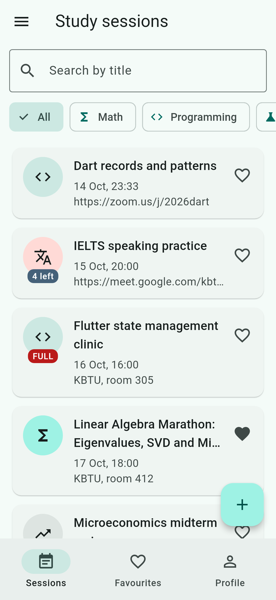
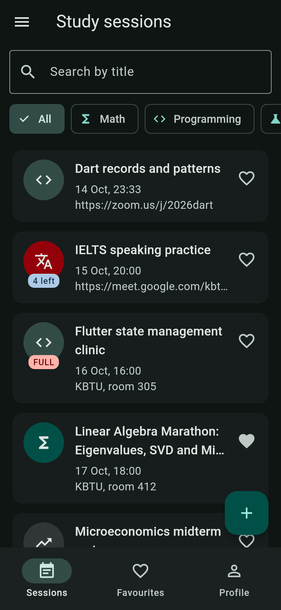
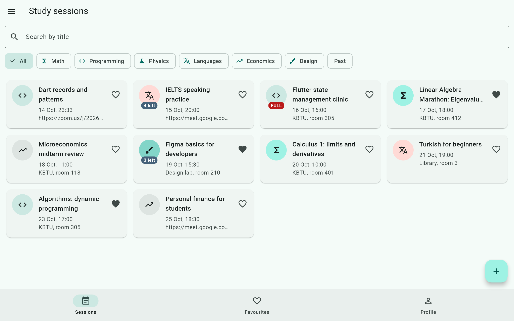

# Study Sessions

Lab 1, Mobile Development, 2026.

**Domain:** study sessions at KBTU and online. A session has a title, a
subject, a start time, a place and a limited number of seats. Students
browse the sessions, join or leave them and keep favourites. An online
session has a link instead of a room. All data lives in memory.

| Model part | In this app |
|---|---|
| title | `title`, 3–60 characters |
| category | `Subject` enum (6 values, label + icon) |
| when | `startsAt`, past vs. upcoming |
| limit | `capacity` |
| the list | `members`, read-only outside the model |
| mode | `isOnline`: the place becomes a link that must contain `://` |
| optional text | `agenda` |
| favourite | `isFavourite` |

## Screenshots

| Phone, light | Phone, dark | Tablet, grid |
|---|---|---|
|  |  |  |

## Structure

```
lib/
  main.dart                 MyApp: theme mode, routes, onGenerateRoute
  routes.dart               Routes names + DetailArgs, FormArgs
  shell.dart                NavigationBar, Drawer; owns sessions and profile
  models/                   StudySession, Subject, Profile, Countdown
  data/seed.dart            twelve sessions relative to today
  utils/format.dart         18 Oct, 10:00
  tabs/                     sessions, favourites, profile
  screens/                  detail, form, not found
  widgets/                  card, avatar, list/grid, empty state, drawer
```

## Decisions

The list of sessions and the profile live in the shell's State, because
three tabs and the detail screen need them and the shell is the closest
widget above all of them. The detail screen receives the session and
callbacks, because joining, leaving and deleting change data the shell owns,
and the shell must hear about it while the detail stays open. The form
returns a session through `pop`, because it only answers one question —
what the session looks like now — and backing out simply answers `null`.
The grid is decided by a `LayoutBuilder`, because the width that matters is
the space the list gets, not the size of the screen. The form's `PopScope`
compares every current value with the values the form opened with, so
typing and deleting the same letter is not a change. With week 9's tools I
would keep the sessions in local storage, so joins and new sessions survive
a restart.
